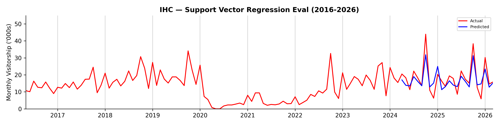
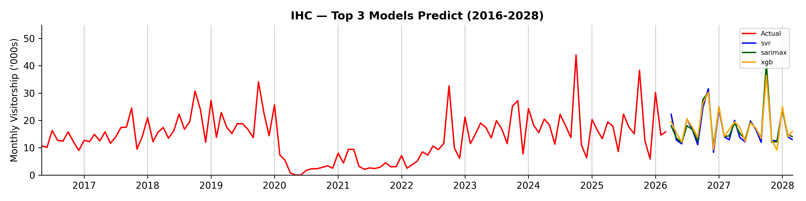

## Summary Report (IHC)

```
Branch:    feature/more-event-features
Generated: 10 Nov 2026 10.24am
```

### Run Config

```
Data Window:           Jan 2014 - Mar 2026
Training Period:       May 2016 - Dec 2023 (92 months)
Evaluation Period:     Jan 2024 - Mar 2026 (27 months)
Prediction Period:     Apr 2026 - Mar 2028 (24 months)
COVID Period:          1 Apr 2020 - 13 Feb 2023
Museum:                Indian Heritage Centre (IHC)
Base Features:         sin_month, cos_month, monthly_avg, is_covid, is_closed, intl_arrivals, lag_1 - lag_12
IHC-specific Features: is_deepavali, is_post_deepavali, prev_deepavali_value
```

### Model Evaluation Results + Predictions

<table><thead><tr><th>Model</th><th>RMSE</th><th>MAPE</th><th>FY2026</th><th>FY2027</th></tr></thead><tbody><tr><td>Support Vector Regression</td><td>4.74</td><td>26.42%</td><td>210.2</td><td>210.5</td></tr><tr><td>SARIMAX</td><td>5.04</td><td>25.52%</td><td>212.2</td><td>215.5</td></tr><tr><td>XGBoost</td><td>5.07</td><td>23.85%</td><td>220.1</td><td>212.5</td></tr><tr><td>Random Forest Regressor</td><td>6.33</td><td>27.75%</td><td>211.1</td><td>210.3</td></tr><tr><td>LSTM</td><td>6.59</td><td>34.34%</td><td>235.5</td><td>221.9</td></tr><tr><td>Baseline Monthly Mean</td><td>9.77</td><td>40.23%</td><td>216.6</td><td>216.6</td></tr><tr><td>Holt-Winters exponential smoothing</td><td>10.30</td><td>43.38%</td><td>196.5</td><td>183.1</td></tr></tbody></table>

### Total Visitors ('000s) by Financial Year (Support Vector Regression)

<table align="left"><thead><tr><th width="138">FY</th><th width="148">Total Visitors ('000s)</th></tr></thead><tbody><tr><td>FY2016</td><td>138.9</td></tr><tr><td>FY2017</td><td>185.5</td></tr><tr><td>FY2018</td><td>236.3</td></tr><tr><td>FY2019</td><td>210.5</td></tr><tr><td>FY2020</td><td>37.6</td></tr><tr><td>FY2021</td><td>46.5</td></tr></tbody></table><table align="right"><thead><tr><th width="138">FY</th><th width="148">Total Visitors ('000s)</th></tr></thead><tbody><tr><td>FY2022</td><td>148.6</td></tr><tr><td>FY2023</td><td>216.2</td></tr><tr><td>FY2024</td><td>215.3</td></tr><tr><td>FY2025</td><td>218.2</td></tr><tr><td>FY2026 (Prediction)</td><td>210.2</td></tr><tr><td>FY2027 (Prediction)</td><td>210.5</td></tr></tbody></table><br clear="all">



**Deepavali months: actual vs predicted (Support Vector Regression)**

| Month | Actual | Predicted | Difference | % difference |
|---|---|---|---|---|
| 2024-10 | 43.90 | 30.62 | -13.28 | -30.26% |
| 2025-10 | 38.30 | 33.50 | -4.80 | -12.54% |
| 2026-11 | -- | 31.56 | -- | -- |
| 2027-10 | -- | 40.01 | -- | -- |


