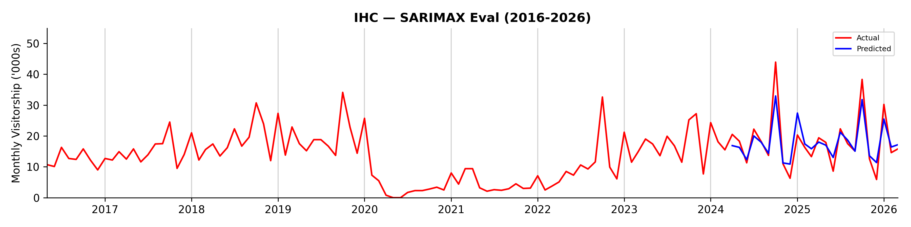

## Summary Report (IHC)

```
Branch:    test/run-pipelines-8e
Generated: 20 Oct 2026 5.50pm
```

### Model Evaluation Results + Predictions

<table><thead><tr><th>Model</th><th>RMSE</th><th>MAPE</th><th>FY2026</th><th>FY2027</th></tr></thead><tbody><tr><td>SARIMAX</td><td>3.81</td><td>18.53%</td><td>218.3</td><td>217.4</td></tr><tr><td>Support Vector Regression</td><td>4.85</td><td>27.96%</td><td>214.1</td><td>212.8</td></tr><tr><td>XGBoost</td><td>4.96</td><td>26.16%</td><td>219.3</td><td>216.2</td></tr><tr><td>Random Forest Regressor</td><td>5.70</td><td>26.76%</td><td>214.7</td><td>208.8</td></tr><tr><td>LSTM</td><td>6.08</td><td>35.97%</td><td>241.5</td><td>228.6</td></tr><tr><td>Holt-Winters exponential smoothing</td><td>6.19</td><td>35.66%</td><td>201.0</td><td>192.4</td></tr><tr><td>Baseline Monthly Mean</td><td>8.79</td><td>33.24%</td><td>216.6</td><td>216.6</td></tr></tbody></table>

### Total Visitors ('000s) by Financial Year (SARIMAX)

<table align="left"><thead><tr><th width="138">FY</th><th width="148">Total Visitors ('000s)</th></tr></thead><tbody><tr><td>FY2016</td><td>138.9</td></tr><tr><td>FY2017</td><td>185.5</td></tr><tr><td>FY2018</td><td>236.3</td></tr><tr><td>FY2019</td><td>210.5</td></tr><tr><td>FY2020</td><td>37.6</td></tr><tr><td>FY2021</td><td>46.5</td></tr></tbody></table><table align="right"><thead><tr><th width="138">FY</th><th width="148">Total Visitors ('000s)</th></tr></thead><tbody><tr><td>FY2022</td><td>148.6</td></tr><tr><td>FY2023</td><td>216.2</td></tr><tr><td>FY2024</td><td>215.3</td></tr><tr><td>FY2025</td><td>218.2</td></tr><tr><td>FY2026 (Prediction)</td><td>218.3</td></tr><tr><td>FY2027 (Prediction)</td><td>217.4</td></tr></tbody></table><br clear="all">



**Deepavali months: actual vs predicted (SARIMAX)**

| Month | Actual | Predicted | Difference | % difference |
|---|---|---|---|---|
| 2024-10 | 43.90 | 32.93 | -10.97 | -24.98% |
| 2025-10 | 38.30 | 31.77 | -6.53 | -17.05% |
| 2026-11 | -- | 28.65 | -- | -- |
| 2027-10 | -- | 37.51 | -- | -- |


