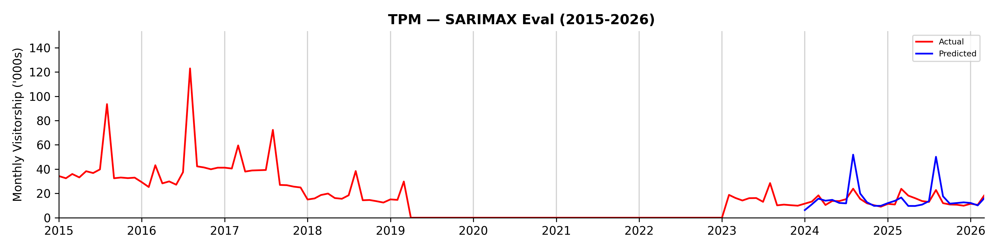

## Summary Report (TPM)

```
Branch:    feature/more-event-features
Generated: 10 Nov 2026 10.16am
```

### Run Config

```
Data Window:           Jan 2014 - Mar 2026
Training Period:       Jan 2015 - Dec 2023 (108 months)
Evaluation Period:     Jan 2024 - Mar 2026 (27 months)
Prediction Period:     Apr 2026 - Mar 2028 (24 months)
COVID Period:          1 Apr 2020 - 13 Feb 2023
Museum:                Peranakan Museum (TPM)
Base Features:         sin_month, cos_month, monthly_avg, is_covid, is_closed, intl_arrivals, lag_1 - lag_12
TPM-specific Features: None
```

### Model Evaluation Results + Predictions

<table><thead><tr><th>Model</th><th>RMSE</th><th>MAPE</th><th>FY2026</th><th>FY2027</th></tr></thead><tbody><tr><td>SARIMAX</td><td>2.93</td><td>17.26%</td><td>146.7</td><td>167.5</td></tr><tr><td>XGBoost</td><td>3.29</td><td>22.28%</td><td>194.9</td><td>209.1</td></tr><tr><td>Support Vector Regression</td><td>3.72</td><td>19.80%</td><td>244.5</td><td>312.9</td></tr><tr><td>Random Forest Regressor</td><td>4.06</td><td>21.44%</td><td>218.1</td><td>237.8</td></tr><tr><td>Holt-Winters exponential smoothing</td><td>9.27</td><td>63.49%</td><td>154.2</td><td>139.2</td></tr><tr><td>LSTM</td><td>9.90</td><td>57.22%</td><td>239.9</td><td>291.0</td></tr><tr><td>Baseline Monthly Mean</td><td>10.17</td><td>68.14%</td><td>170.1</td><td>170.1</td></tr></tbody></table>

### Total Visitors ('000s) by Financial Year (SARIMAX)

<table align="left"><thead><tr><th width="138">FY</th><th width="148">Total Visitors ('000s)</th></tr></thead><tbody><tr><td>FY2014</td><td>102.8</td></tr><tr><td>FY2015</td><td>470.6</td></tr><tr><td>FY2016</td><td>551.8</td></tr><tr><td>FY2017</td><td>381.5</td></tr><tr><td>FY2018</td><td>223.3</td></tr><tr><td>FY2019</td><td>0.0</td></tr><tr><td>FY2020</td><td>0.0</td></tr></tbody></table><table align="right"><thead><tr><th width="138">FY</th><th width="148">Total Visitors ('000s)</th></tr></thead><tbody><tr><td>FY2021</td><td>0.0</td></tr><tr><td>FY2022</td><td>35.1</td></tr><tr><td>FY2023</td><td>172.6</td></tr><tr><td>FY2024</td><td>170.1</td></tr><tr><td>FY2025</td><td>167.6</td></tr><tr><td>FY2026 (Prediction)</td><td>146.7</td></tr><tr><td>FY2027 (Prediction)</td><td>167.5</td></tr></tbody></table><br clear="all">




