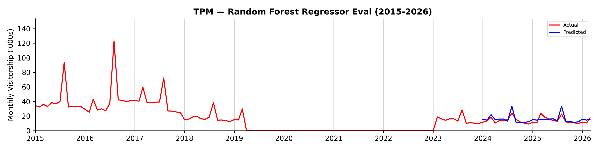
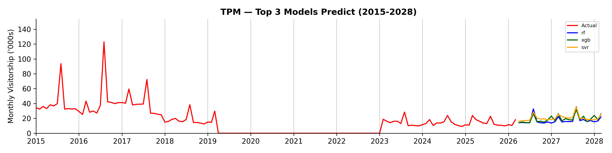

## Summary Report (TPM)

```
Branch:    test/run-pipelines-8d
Generated: 20 Oct 2026 5.02pm
```

### Model Evaluation Results + Predictions

<table><thead><tr><th>Model</th><th>RMSE</th><th>MAPE</th><th>FY2026</th><th>FY2027</th></tr></thead><tbody><tr><td>Random Forest Regressor</td><td>2.64</td><td>14.00%</td><td>199.6</td><td>221.0</td></tr><tr><td>XGBoost</td><td>2.75</td><td>15.82%</td><td>214.8</td><td>248.6</td></tr><tr><td>Support Vector Regression</td><td>3.69</td><td>14.23%</td><td>236.7</td><td>260.4</td></tr><tr><td>SARIMAX</td><td>8.28</td><td>27.01%</td><td>69.9</td><td>44.8</td></tr><tr><td>Baseline Monthly Mean</td><td>10.17</td><td>68.14%</td><td>170.1</td><td>170.1</td></tr><tr><td>LSTM</td><td>12.24</td><td>57.03%</td><td>309.5</td><td>358.2</td></tr><tr><td>Holt-Winters exponential smoothing</td><td>12.93</td><td>88.56%</td><td>166.6</td><td>171.6</td></tr></tbody></table>

### Total Visitors ('000s) by Financial Year (Random Forest Regressor)

<table align="left"><thead><tr><th width="138">FY</th><th width="148">Total Visitors ('000s)</th></tr></thead><tbody><tr><td>FY2014</td><td>102.8</td></tr><tr><td>FY2015</td><td>470.6</td></tr><tr><td>FY2016</td><td>551.8</td></tr><tr><td>FY2017</td><td>381.5</td></tr><tr><td>FY2018</td><td>223.3</td></tr><tr><td>FY2019</td><td>0.0</td></tr><tr><td>FY2020</td><td>0.0</td></tr></tbody></table><table align="right"><thead><tr><th width="138">FY</th><th width="148">Total Visitors ('000s)</th></tr></thead><tbody><tr><td>FY2021</td><td>0.0</td></tr><tr><td>FY2022</td><td>35.1</td></tr><tr><td>FY2023</td><td>172.6</td></tr><tr><td>FY2024</td><td>170.1</td></tr><tr><td>FY2025</td><td>167.6</td></tr><tr><td>FY2026 (Prediction)</td><td>199.6</td></tr><tr><td>FY2027 (Prediction)</td><td>221.0</td></tr></tbody></table><br clear="all">




